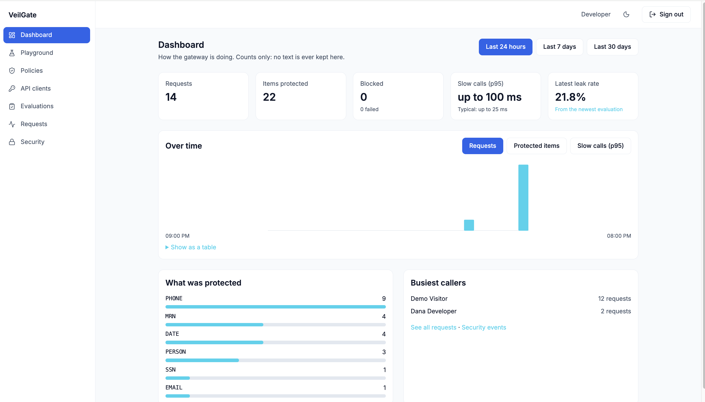
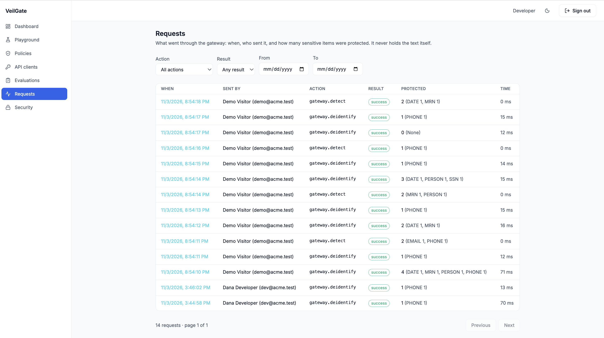
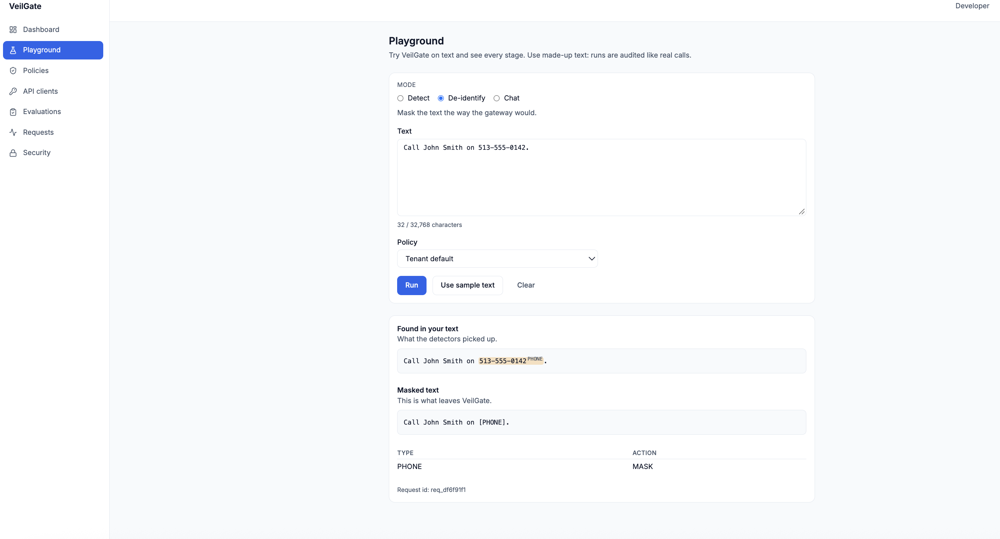
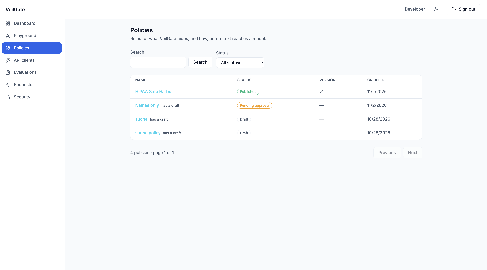
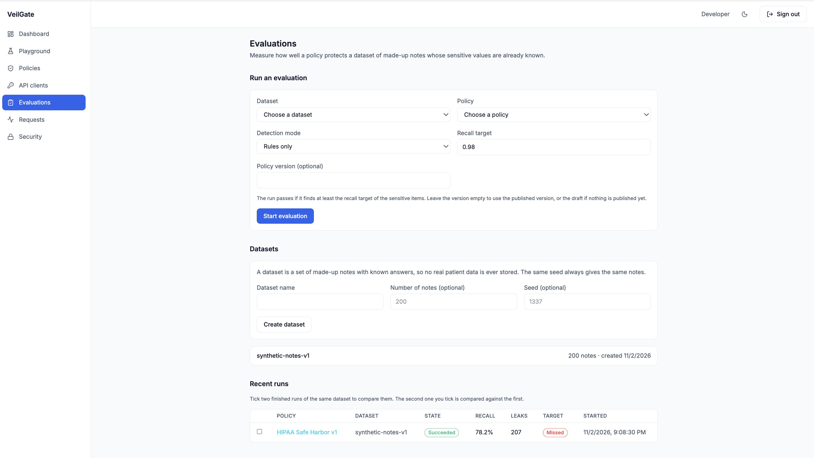
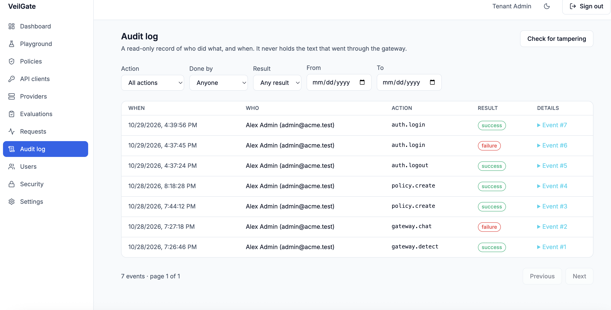
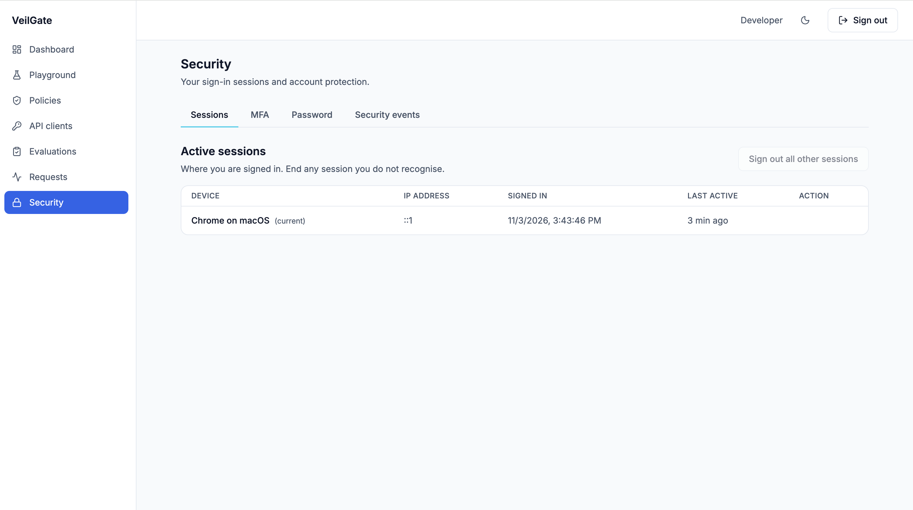

# VeilGate

[](https://github.com/sudha-bhavi/veilgate/actions/workflows/ci.yml)

A multi-tenant gateway that finds protected health information (PHI) in text, replaces it according to a policy,
sends only the sanitized text to an LLM, and restores the values in the answer.

> **All data in this project is synthetic. VeilGate is not certified for real PHI.**

```
your app ──► VeilGate ──► LLM provider
              │
              ├─ finds PHI: names, dates, ID numbers, phone numbers ...
              ├─ replaces it using a policy: redact, mask, tokenize, or shift dates
              ├─ checks the model's answer for anything that leaked
              └─ puts the original values back in the answer
```

Design documents (PRS, UI, Backend, Database, Security, Pen test plan, Test cases, Deployment) describe everything below.

## Highlights

- **Policies as YAML**, with a real approval workflow: draft, validate, submit, approve by a _different_ person, publish.
  Every version is kept, can be compared (diff), and can be rolled back.
- **OpenAI-compatible endpoint.** Existing clients only change their base URL. API clients have scoped credentials,
  rate limits, network allowlists, and secret rotation with a grace period.
- **Tenant isolation in the database.** PostgreSQL row-level security on every tenant table.
- **Reversible protection.** Values are encrypted with AES-256-GCM under a per-tenant data key and swapped for tokens,
  so the answer can be restored.
- **Careful sign-in.** Argon2id passwords, ES256 tokens with a public key set, authenticator-app MFA with recovery codes,
  and a fresh second-factor check ("step-up") before sensitive actions such as publishing a policy or creating a client.
- **Tamper-evident audit.** An append-only, hash-chained log of counts and ids, never text.
- **Measured quality.** Evaluations run a policy over synthetic notes with known answers and report recall, precision,
  F1 and leaks per type, and can compare two runs.
- **People and invitations.** Tenant Admins invite colleagues by email (a single-use link that expires after 48 hours),
  choose their role, disable accounts, and reset someone's two-step sign-in.
- **My sessions.** Every signed-in person, whatever their role, can open **Security** in the console to see where they
  are signed in (device, IP address, when, last active), end a session they do not recognise, or sign out all other
  sessions. The IP address and browser are recorded when a session starts.
- **Your own account.** The **MFA** tab shows your authenticator app and how many recovery codes are left, and replaces
  them (after a fresh second-factor check). The **Password** tab changes your password and signs out your other devices.
- **Security events.** The **Security events** tab lists failed sign-in lockouts, two-step resets, blocked leaks and API
  client problems. Tenant Admins and Security Officers see the whole organisation and can filter by person; everyone
  else sees only events about their own account.
- **A read-only demo.** An optional "Try the demo" button on the sign-in page lets a visitor look around with sample
  data, without an account. It is off by default and cannot change anything (see "Try the demo" below).
- **An event pipeline.** Every gateway call is announced through a transactional outbox to Kafka (Redpanda locally), with retries,
  a dead-letter topic and an idempotent consumer that builds the Requests page and the Dashboard counters. See "M6" below.
- **A React console** for all of it: dashboard, playground, policies with a YAML editor, API clients, providers, evaluations,
  requests, the audit log and users.

## Screenshots

All data shown is synthetic.





More of the console:











## Tech stack

| Area     | What                                                                                          |
| -------- | --------------------------------------------------------------------------------------------- |
| Backend  | .NET 10, ASP.NET Core, FluentValidation, Polly (retries and circuit breaker for LLM calls)    |
| Data     | PostgreSQL 16 with row-level security, EF Core migrations                                     |
| Frontend | React 19, TypeScript, Vite, Tailwind CSS 4, TanStack Query, React Router, Monaco editor       |
| Testing  | xUnit (backend), Vitest and Testing Library (frontend), throwaway Postgres for database tests |
| Local    | Docker Compose: Postgres, Redis, Redpanda (Kafka), MailHog, WireMock                          |

## Status

| Milestone | Scope                                                                                               | State   |
| --------- | --------------------------------------------------------------------------------------------------- | ------- |
| M0        | Solution skeleton, Docker Compose, Postgres roles, health endpoint, first tests                     | ✅ Done |
| M1        | Tenants, users, EF migrations with RLS, login + MFA + JWT + refresh                                 | ✅ Done |
| M2        | Detection engine, policy engine, tokenizer + vault                                                  | ✅ Done |
| M3        | Gateway endpoints, LLM provider with Polly, audit hash chain                                        | ✅ Done |
| M4        | Policy workflow, API clients, LLM providers, evaluations, step-up check                             | ✅ Done |
| M5        | React console: sign-in, playground, policies, API clients, providers, evaluations, audit log, users | ✅ Done |
| M5+       | Security page, read-only demo, invitations                                                          | ✅ Done |
| M6        | Kafka outbox, workers, dashboards                                                                   | ✅ Done |
| M7        | Hardening, pen test, deployment                                                                     | 🚧 In progress |

In the console, Settings is read-only: it shows the organisation and the server-wide sign-in and session rules (`GET /api/v1/settings`,
Tenant Admins only). Renaming the organisation, a default policy and request-history retention are not built (the app's database role
cannot write the tenants table by design). Everything else works end to end, including the Security page (sessions, two-step sign-in, password and security
events). Passkeys are not built yet.

## Run it locally

You need the .NET 10 SDK, Docker Desktop, Git and Node 22 or newer.

**1. Set up the database and tools**

```bash
./setup.sh                      # Windows: .\setup.ps1
cp .env.example .env            # Windows: copy .env.example .env  (then edit the passwords inside)
docker compose -f deploy/docker-compose.yml --env-file .env up -d
dotnet tool restore
dotnet ef database update --project src/VeilGate.Infrastructure --startup-project src/VeilGate.Api
```

**2. Start the API** (on port 5080, because macOS uses port 5000 for AirPlay)

```bash
ASPNETCORE_ENVIRONMENT=Development ASPNETCORE_URLS=http://localhost:5080 dotnet run --project src/VeilGate.Api
curl http://localhost:5080/health/live          # in another terminal
```

**3. Start the worker** (it runs evaluations)

```bash
DOTNET_ENVIRONMENT=Development dotnet run --project src/VeilGate.Workers
```

**4. Create the demo organisation and people.** Use the `vg_migrator` password from your `.env`, and choose your own
password of at least 12 characters for the demo people:

```bash
dotnet run --project tools/VeilGate.Seeder -- --connection "Host=localhost;Database=veilgate;Username=vg_migrator;Password=<PG_MIGRATOR_PASSWORD from .env>" --password "<a password you choose>"
```

This creates the tenant "Acme Health" and one person per role: `admin@acme.test` (Tenant Admin),
`security@acme.test` (Security Officer), `dev@acme.test` (Developer) and `auditor@acme.test` (Auditor).
The seeder only works on a database on your own machine.

It also creates some sample content in that organisation, so the console has something to show: a published policy
("HIPAA Safe Harbor") and one waiting for approval ("Names only"), an API client (`ehr-bridge`, whose secret is printed
once in the terminal), a dataset of 200 invented notes, and a queued evaluation run that the worker finishes. Running
the seeder again changes nothing. It also creates `demo@acme.test`, a Security Officer with a random, discarded
password and no authenticator, who is only reachable through the optional demo button below.

**5. Start the console**

```bash
cd src/VeilGate.Web
npm install
npm run dev
```

Open <http://localhost:5173> in Chrome. The first sign-in asks you to set up an authenticator app and shows
one-time recovery codes. Keep them: they are shown only once.

When you add a model provider, enter its address without `/v1` (for the WireMock container: `http://localhost:8089`).
VeilGate adds `/v1/chat/completions` itself.

**My sessions**

Apply the migration that adds the `ip` and `user_agent` columns to sessions (`AddSessionIpUserAgent`), the same way as
the others:

```bash
dotnet ef database update --project src/VeilGate.Infrastructure --startup-project src/VeilGate.Api
```

Sessions that were already open before the migration have no IP address or browser, so they show as "Unknown device"
until the person signs in again. The API offers three calls to every signed-in person, and only ever for their own
sessions:

- `GET /api/v1/auth/sessions` lists the active ones, with the one the request is using marked `current`.
- `DELETE /api/v1/auth/sessions/{id}` ends another one. Ending the session in use is refused (`409 session.current`);
  that is a sign-out. Someone else's session is "not found".
- `POST /api/v1/auth/logout-all` with `{"keepCurrent": true}` (the default) signs out every other session. It needs a
  recent second-factor check, like the other sensitive actions.

An ended session stops working at once. The API looks up the session of every signed-in request, so after a sign-out, a
revoke, "sign out all other sessions", a password change, or disabling the person, that device's very next request is
refused with `401 auth.token_invalid`, and the console signs it out. A token whose session has no record is not refused
by this check, in the same way an unknown API client is not (a forged token already fails its signature). The idle
timeout is not checked per request: it only moves when a session is renewed, and an access token lasts
`Auth__AccessTokenMinutes` (10 by default) at most. A demo session can look at the list but cannot end anything.

**Two-step sign-in and password**

Three calls for every signed-in person, always about themselves. No migration is needed.

- `GET /api/v1/auth/mfa/factors` returns when the authenticator app was added (or `null`) and how many recovery codes are
  left of how many.
- `POST /api/v1/auth/mfa/recovery-codes/regenerate` replaces all recovery codes, used or not, and returns the 10 new ones
  once. It needs a recent second-factor check. The old codes stop working at once.
- `POST /api/v1/auth/password/change` with `{"currentPassword", "newPassword"}` returns `204`. A wrong current password is
  `400 password.current_incorrect` and counts toward the account lockout (5 in a row lock it for 15 minutes). The new
  password follows the same rules as at sign-up (12 to 128 characters) and must differ from the current one. On success
  the person's other sessions end and their token version goes up, so every other device is signed out at once; the
  device that made the change stays signed in and quietly renews its token.

Each of these writes an audit event and a security event (Info), so they appear on the Security events tab. The
authenticator app cannot be removed here, because it is the only second factor, and passkeys are not built yet. A demo
session can look but not change anything.

**Security events**

`GET /api/v1/security-events` is open to every person of the tenant, and what comes back depends on the role. Tenant
Admins and Security Officers get the whole organisation and may narrow it with `userId`, `severity`, `from` and `to`.
Everyone else always gets only events about their own account; asking for another person's is refused with
`403 security_events.own_only`. `GET /api/v1/security-events/people` lists the people for the console's User filter and
is for Tenant Admins and Security Officers only. Another organisation's events are never visible. No migration is needed.

Events about an API client (a wrong secret, a blocked address) have no person, so only the two oversight roles see them.
The table keeps no browser information for security events, so a row shows time, type, IP address and details.

**Try the demo (optional)**

The sign-in page can offer a "Try the demo" button that signs a visitor in as the seeded `demo@acme.test` (a Security
Officer), with no password and no authenticator. It is **off by default**. First apply the migration that adds the
`is_demo` column to sessions (`AddSessionDemoFlag`), then start the API with `Demo__Enabled=true`:

```bash
dotnet ef database update --project src/VeilGate.Infrastructure --startup-project src/VeilGate.Api
ASPNETCORE_ENVIRONMENT=Development ASPNETCORE_URLS=http://localhost:5080 Demo__Enabled=true dotnet run --project src/VeilGate.Api
```

- **Read-only.** A demo session can look at every page a Security Officer can see, try the Playground, test a policy
  on sample text, and sign out. Every other change is refused with `403 demo.read_only`, before it reaches a controller.
  That includes the step-up check, so a demo session can never publish or roll back a policy.
- **Marked and short.** The session is flagged as a demo in the database and in its token (sign-in method `demo`), it
  lasts one hour, and refreshing it keeps it a demo session. Every demo sign-in is recorded in the audit log
  (`auth.demo_login`).
- **Never an administrator.** The API refuses to sign in a demo user who is a Tenant Admin or Platform Admin. The
  settings are `Demo__Enabled` (default `false`) and `Demo__UserEmail` (default `demo@acme.test`).

> **Warning.** This button skips the passwords and two-step sign-in that the rest of VeilGate insists on. Switch it on
> only for a sandbox organisation that holds synthetic data and nothing else. The go-live checklist in the deployment
> document (seed accounts removed, MFA enforced for everyone) still applies to a real deployment.

**Check the console under its production security policy**

In production the API serves the built console itself (same origin, which the `SameSite=Strict` refresh cookie
needs), with a Content-Security-Policy that allows only its own files: no inline scripts, no `eval`, and Monaco's
worker as a plain file. `npm run dev` does not apply that policy, because hot reload needs inline scripts. To see the
built console under it, with the API running:

```bash
cd src/VeilGate.Web
npm run build && npm run preview     # then open http://localhost:4173 and watch the browser console for CSP errors
```

The policy lives in `SecurityHeadersMiddleware.ConsolePolicy` and is copied into `vite.config.ts` for the preview.
The Docker image (`deploy/Dockerfile.api`) builds the console and puts it in the API's `wwwroot`.

**Run the tests**

```bash
dotnet test                                  # backend
cd src/VeilGate.Web && npm test              # frontend
```

If you change the passwords in `.env`, put the same `vg_app` password in
`src/VeilGate.Api/appsettings.Development.json` (or use user-secrets:
`dotnet user-secrets set "ConnectionStrings:Postgres" "Host=localhost;Database=veilgate;Username=vg_app;Password=..." --project src/VeilGate.Api`).

If the database volume already existed before you changed passwords, remove it so the roles are recreated:
`docker compose -f deploy/docker-compose.yml down -v`.

## Layout

```
src/VeilGate.Domain          entities, Result<T>, no dependencies
src/VeilGate.Application     use cases, interfaces, validators
src/VeilGate.Infrastructure  EF Core, tenant interceptor, external services
src/VeilGate.Api             controllers, middleware, composition root
src/VeilGate.Workers         background services (outbox, purger, evaluations)
src/VeilGate.Web             the React console
tools/VeilGate.Seeder        creates the demo organisation and people (local databases only)
tests/                       xUnit tests
deploy/                      Docker Compose, Dockerfiles, Postgres init, WireMock
```

## Development notes by milestone

These are the build notes, kept as written. Their `curl` examples use port 5000, the .NET default; on macOS use 5080
as above.

### M1a: database schema and row-level security

```bash
dotnet tool restore                      # installs dotnet-ef from .config/dotnet-tools.json
dotnet sln VeilGate.slnx add tests/VeilGate.Infrastructure.Tests
docker compose -f deploy/docker-compose.yml --env-file .env down -v   # re-runs init.sh (adds vg_platform, vg_audit_writer)
docker compose -f deploy/docker-compose.yml --env-file .env up -d

dotnet ef migrations add InitialSchema --project src/VeilGate.Infrastructure --startup-project src/VeilGate.Api --output-dir Persistence/Migrations
```

Open the generated `Persistence/Migrations/<timestamp>_InitialSchema.cs` and add these lines at the **end** of `Up(...)`, before its closing brace:

```csharp
migrationBuilder.CreateTenantFunction();
migrationBuilder.ProtectTenantsTable();
migrationBuilder.ProtectTenantTable("users");
migrationBuilder.CreateLoginLookupFunction();
```

and `using VeilGate.Infrastructure.Persistence.Sql;` at the top. Then:

```bash
dotnet ef database update --project src/VeilGate.Infrastructure --startup-project src/VeilGate.Api
dotnet test
```

### M1b: login, Argon2id, JWT (ES256), JWKS

New project `tests/VeilGate.TestSupport` (shared throwaway-Postgres helper). Register it, restore and test:

```bash
./setup.sh                      # recreates VeilGate.slnx with the new project
dotnet build
dotnet test                     # first run downloads a NuGet package or two
```

No new migration is needed. To try it by hand, create a user in the dev database (the seeder above does this), then:

```bash
ASPNETCORE_ENVIRONMENT=Development dotnet run --project src/VeilGate.Api
curl -s http://localhost:5000/.well-known/jwks.json
curl -s -X POST http://localhost:5000/api/v1/auth/login -H 'Content-Type: application/json' -d '{"email":"a@b.test","password":"x"}'
```

In Development the API creates a temporary signing key at startup. In any other environment you must set `Auth__Keys__0__Kid` and `Auth__Keys__0__PrivateKeyPem`
(generate with `openssl ecparam -name prime256v1 -genkey -noout`).

### M2: detection, policy, transformation, vault

Pure logic first, then the encrypted vault. No HTTP endpoints yet (those are M3).

```
text -> TextNormalizer -> DetectionPipeline (RegexDetector, DictionaryDetector) -> PolicyEngine (PolicyParser reads the YAML)
     -> Transformer (MASK / REDACT / TOKENIZE / SHIFT) -> OutboundLeakGate -> [LLM] -> Rehydrator (tokens back to originals)
```

- Vault: values are encrypted with AES-256-GCM under a per-tenant data key; the data key is stored wrapped by a master key.
- New migration `AddVault` (tables `tenant_keys`, `vault_sessions`, `vault_tokens`, all with row-level security). Apply it with `dotnet ef database update --project src/VeilGate.Infrastructure --startup-project src/VeilGate.Api`.
- New setting `Security:VaultKek` (32 random bytes, base64). `appsettings.Development.json` has a development-only value. In any other environment set it yourself: `openssl rand -base64 32` (production will use Key Vault).
- Token format is `[[TYPE_XXXX]]` (underscore), as in Backend doc 6.2 and Database doc 3.4.

### M3: the gateway

```
POST /api/v1/gateway/detect            scope gateway:detect       find entities, positions only
POST /api/v1/gateway/deidentify        scope gateway:deidentify   safe text + vault session
POST /api/v1/gateway/reidentify        scope gateway:reidentify   put the originals back
POST /api/v1/gateway/chat/completions  scope gateway:invoke       OpenAI-compatible: protect, forward, check, restore
POST /api/v1/playground/run            signed-in Developer / Security Officer / Tenant Admin
```

- **Tokens.** Gateway endpoints take a _client_ token (claims `client_id`, `tid`, `scope`); a person's token is refused there, and a client token is refused on every console endpoint.
  Client tokens are issued by `POST /oauth/token` for a stored API client (M4d). The playground works for a signed-in user.
- **Policy.** The policy named in the request, else the API client's default policy, else the built-in `hipaa-safe-harbor` template (`PolicyTemplates`). Stored policies arrived in M4a to M4c.
- **Model providers** are per tenant and live in the database since M4e (see below). Each provider gets its own timeouts, retries (2, with backoff and jitter), circuit breaker and concurrency limit, and the destination address is checked against private and metadata ranges on every connection (set `Llm:AllowPrivateNetworks` only in Development).
- **Audit.** Every gateway call appends a row to `audit_events`, a per-tenant hash chain (`HashChainAuditWriter`, verified by `AuditChainVerifier`). The table is append-only: the app role cannot UPDATE or DELETE, and a trigger refuses it for everyone.
  Rows hold counts and ids, never text. Blocked leaks are written to `security_events`.
- **Apply the new migrations** to your dev database (`AddAuditEvents`, `AddSecurityEvents`, plus `AddVault` from M2):

```bash
dotnet ef database update --project src/VeilGate.Infrastructure --startup-project src/VeilGate.Api
```

Not in M3: streaming responses, FHIR, idempotency keys, the `gateway_requests` / `detections` tables and their partitions, signed audit checkpoints, and the ONNX name model (a rule-based name detector stands in).

### M4: stored policies, API clients, LLM providers

```
/api/v1/policies ...             draft (If-Match), validate, submit, publish, reject, rollback, archive, versions, diff, test
/oauth/token                     client credentials: client id + secret -> 15-minute gateway token
/api/v1/api-clients ...          create (secret shown once), update, rotate-secret (grace period), revoke
/api/v1/llm-providers ...        connect, update, order (failover), test, delete        Tenant Admin only
/api/v1/auth/step-up             renew the 5-minute second-factor check without signing in again
```

- **Policy workflow.** The person who submits a policy cannot publish it (`policy.self_approval`). Publishing and rolling back need a second-factor check in the last 5 minutes; a stored policy that no longer matches its hash, or no longer parses, is refused rather than replaced.
- **API clients.** A secret is shown once and stored as an Argon2id hash; a rotation keeps the old secret working for 1, 24 or 168 hours. Revoking a client stops its tokens on the very next call. A client has its own rate limit, an optional network allowlist and an optional default policy.
- **LLM providers.** Each tenant connects its own providers (address, API key, models, timeout, failover order). The key is encrypted with the tenant's data key, bound to its provider, and never returned (only its last four characters). Changing a provider's address requires entering the key again. In Development, to use the WireMock container (a Tenant Admin's token in `$TOKEN`):

```bash
curl -s -X POST http://localhost:5000/api/v1/llm-providers -H "Authorization: Bearer $TOKEN" -H 'Content-Type: application/json' \
  -d '{"name":"mock-llm","baseUrl":"http://localhost:8089","apiKey":"dev-not-a-secret","models":["gpt-4o-mini"]}'
```

- **The `Llm:Providers` configuration list is gone.** Remove any `Llm__Providers__*` environment variables; they are ignored. Only the shared settings (`AllowPrivateNetworks`, retry and breaker tuning) remain in `Llm`.
- **Apply the new migrations** to your dev database (`AddPolicies`, `AddApiClients`, `AddLlmProviders`):

```bash
dotnet ef database update --project src/VeilGate.Infrastructure --startup-project src/VeilGate.Api
```

### M4f: evaluations

```
/api/v1/datasets ...             create a synthetic dataset (invented notes with known answers), list, read
/api/v1/evaluations ...          start a run, list, read progress, leaks, report (json or md), compare two runs
```

- **A run measures a policy version on a dataset.** Every note goes through the same path as the gateway (detect, then the policy decides) and is scored against the labels: recall, precision and F1 per type, and **leaks** (a value the policy protects that was not fully covered). The gate passes only if recall reaches the threshold (default 98%) **and** nothing leaked.
- **Runs are queued.** `POST /evaluations` returns 202 and the worker does the work: `DOTNET_ENVIRONMENT=Development dotnet run --project src/VeilGate.Workers`. Until Kafka arrives in M6 the `eval_runs` table is the queue; a run abandoned by a crashed worker is taken again, up to 3 attempts.
- **Datasets are synthetic only.** The same seed always gives the same notes, so two policies can be compared on identical data. Compare only works for runs of the same dataset.
- **Modes.** `rules` uses the pattern and dictionary detectors; `rules+ner` adds the name detector (a rule-based stand-in for the ONNX model).
- **Apply the new migration** (`AddEvaluation`) to your dev database:

```bash
dotnet ef database update --project src/VeilGate.Infrastructure --startup-project src/VeilGate.Api
```

### M5: the console

The React console lives in `src/VeilGate.Web`. Its dev server proxies `/api` and `/oauth` to the API on port 5080
(`vite.config.ts`), so the browser only ever talks to one address and the HttpOnly refresh cookie behaves as it will in production.

- The access token is kept in memory only; a reload brings the session back through the refresh cookie.
- Menu items and pages follow the server's role rules, but the server checks every request itself.
- Idle sign-out after 15 minutes, with a warning one minute before.
- Dialogs trap keyboard focus, tabs work with the arrow keys, and there is a "skip to main content" link.

### M5: users and invitations

```
GET   /api/v1/users ...                    list, search, filter by role and status           Tenant Admin only
POST  /api/v1/users                        invite by email and role
PATCH /api/v1/users/{id}                   change role                                        needs the second-factor check
POST  /api/v1/users/{id}/disable           and /enable
POST  /api/v1/users/{id}/invite/resend     a fresh link; every older link stops working
POST  /api/v1/users/{id}/mfa/reset         remove their authenticator and recovery codes      needs the second-factor check
GET   /api/v1/auth/invitations?token=...   show an invitation                                 no sign-in
POST  /api/v1/users/accept-invite          choose a name and password                         no sign-in
```

- **The link.** An invitation works once and lasts 48 hours. Only a hash of its token is stored. A link that is unknown, used, expired or replaced always gets the same answer, so it tells a stranger nothing. The token travels in the query string, not the path, because the request log records the path and a token must never be logged.
- **After accepting,** the person chooses a name and password and goes straight on to set up two-step sign-in, exactly as on a first sign-in.
- **Rules.** Nobody can change, disable or reset their own account, the last active Tenant Admin is protected, and `PlatformAdmin` cannot be handed out. An email address can belong to only one account in the whole system, because sign-in finds a person by email alone.
- **Signing people out.** Disabling someone or resetting their two-step sign-in ends all their sessions. Changing a role makes their old tokens stop working. A reset also removes their recovery codes and raises a security event.
- **Email.** In Development the API sends to MailHog, which keeps every message in a local inbox at <http://localhost:8025> and sends nothing to the internet. The settings are `Smtp` and `Console:BaseUrl` in `appsettings.Development.json`; they have no defaults elsewhere, so a deployment that forgets them fails loudly instead of emailing links to `localhost`. If an email cannot be sent, the person is still invited and the admin can use "Resend invite".
- **Apply the new migration** (`AddInvitations`) to your dev database:

```bash
dotnet ef database update --project src/VeilGate.Infrastructure --startup-project src/VeilGate.Api
```

### M6: the outbox

Gateway events will travel through Kafka (Redpanda locally) to a worker that fills the Dashboard and Requests pages. The first
step is the outbox: a table that holds each message until a worker has sent it.

- **Why an outbox.** A request's work and its message must not drift apart. `IOutbox.Enqueue` adds the message to the same
  database transaction as the work, so both are saved or neither is. A separate worker sends the message afterwards.
- **What a message holds.** A topic, a key (the tenant id, so one tenant's messages stay in order), a JSON payload and the headers
  `messageId`, `tenantId`, `schemaVersion` and, when there is one, `traceparent`. Like the audit log it never holds content.
- **Access.** The app role can read and add messages of its own tenant only. It cannot update or delete them; the publisher
  does that through four narrow database functions (`outbox_claim_due`, `outbox_mark_sent`, `outbox_mark_failed`, `outbox_mark_dead`).

### M6: the publisher

A worker (`OutboxPublisherWorker`) sends outbox messages to Kafka. It talks to an `IEventTransport`, so the broker can be swapped
for the in-memory stand-in with `Messaging:Transport` set to `InMemory`.

- **Claiming with a lease.** The worker takes due messages with `FOR UPDATE SKIP LOCKED`, so two workers never take the same row.
  Because the lock ends when the database call ends, a claim also counts the attempt and moves `next_attempt_at` 60 seconds ahead.
  If a worker dies after claiming, the lease runs out and the message is tried again.
- **Retries.** A failed send waits 2, 4, 8, 16 seconds and so on, up to 5 minutes, and stores the kind of error in `last_error_code`.
- **Dead letters.** After 5 failed attempts the message is copied to `<topic>.dlq` with the headers `x-error` and `x-attempts`, and
  the row is finished. If the dead-letter topic is also unreachable, the message stays in the outbox.
- **Delivery is at least once.** If the worker dies after Kafka accepted a message but before the row was marked sent, the message
  is sent again. Consumers must ignore repeats; the `messageId` header identifies a message.
- **Kafka settings.** `acks=all` and an idempotent producer, so a retry inside the producer never stores a message twice.
- **Running it.** Start the broker and create the topics, then the worker:

```bash
docker compose -f deploy/docker-compose.yml --env-file .env up -d kafka kafka-init
DOTNET_ENVIRONMENT=Development dotnet run --project src/VeilGate.Workers
```

  To watch a topic: `docker compose -f deploy/docker-compose.yml --env-file .env exec kafka rpk topic consume vg.gateway.requests.v1 --offset end`.
  The worker reaches Kafka at `localhost:19092`; containers use `kafka:9092`.

### M6: gateway events

Every gateway call that is written to the audit log (detect, deidentify, reidentify, chat; success, denied or failed) also puts
one event on `vg.gateway.requests.v1`. The metrics consumer and the Requests page are built from these events.

- **Same transaction as the audit row.** The pipeline queues the event and then writes the audit row. The audit writer's save
  stores both, so a failed audit write leaves no event behind and an event never exists without its audit row.
- **What an event holds.** Request id, time, tenant, client, user or client, action, result, how many values of each entity type
  were protected, latency, and for chat the model, provider and policy version. For a denied or failed call it holds the reason
  code. It never holds text, found values or tokens.
- **Time.** The event and the audit row use the same clock reading, so they match exactly.
- **Not every failure is announced.** A call that fails before it is audited (for example an unknown policy) is neither audited
  nor announced.

### M6: the metrics consumer

`MetricsAggregatorWorker` reads `vg.gateway.requests.v1` as the consumer group `vg-metrics-aggregator` and fills three tables:
`gateway_requests` (one row per call, for the Requests page), `metrics_hourly` (counters per tenant, client and UTC hour, for the
Dashboard) and `processed_messages`.

- **Exactly-once effect from at-least-once delivery.** For each message one database transaction records the message id in
  `processed_messages`, adds the request row and adds the event to the hour's counters. If the id is already there, the message
  is skipped. A crash in the middle rolls everything back, and the message is read again.
- **No lost updates.** The hour's row is locked (`SELECT ... FOR UPDATE`) while it is updated, so messages for the same hour
  that arrive together are added one after the other.
- **Offsets.** Auto-commit is off. The consumer commits a message's offset only after its transaction committed. If handling
  fails, it seeks back to that message and retries after 1, 2, 4 ... up to 30 seconds.
- **Bad messages.** A message that is not a valid event goes to `vg.gateway.requests.v1.dlq` with an `x-error` header and the
  consumer moves on. A temporary failure (such as the database being down) is never dead-lettered; it is retried.
- **Latency.** Stored as counts per band (up to 25, 50, 100, 250 ms and so on); p50 and p95 are worked out from the bands on read, and are
  the upper limit of a band, not an exact time.
- **Swappable.** The worker talks to `IEventConsumer`; Kafka is one implementation. With `Messaging:Transport` set to `InMemory` it reads nothing.

### M6: the Requests page

```
GET /api/v1/requests            list, newest first; filters: from, to, action, status, clientId, requestId; page, pageSize
GET /api/v1/requests/{id}       one request
GET /api/v1/requests/actions    the actions that occur, for a filter list
```

- **Who can see it.** Every person of the tenant (Tenant Admin, Security Officer, Developer, Auditor). API client tokens cannot.
  Another tenant's requests are never visible: row-level security limits every query.
- **What a row holds.** Time, who sent it, action, result, how many values of each entity type were protected, latency, and for chat
  the model, provider and policy version, plus the reason a call was denied or failed. Never the text.
- **A moment after the call.** Rows are written by the metrics consumer, so a call appears once its event has travelled through Kafka.
- **In the console.** Requests lists the calls with filters (kept in the address bar, so a view can be bookmarked) and a pager; each
  row opens its own page.

### M6: the Dashboard

```
GET /api/v1/dashboard/summary?range=24h|7d|30d
GET /api/v1/dashboard/timeseries?range=24h|7d|30d&metric=requests|entities|latency
```

- **Where the numbers come from.** The hourly counters that the metrics consumer keeps, so they lag the gateway by a moment. Every
  person of the tenant can read them; they are counts only.
- **Summary.** Requests, items protected, blocked (denied) and failed calls, p50 and p95 latency, the leak rate of the newest successful
  evaluation, items protected by type, and the five busiest callers (an API client or, for the Playground, a person).
- **Charts.** The last 24 hours are hourly points; 7 and 30 days are daily points on UTC days. Every hour or day has a point, so a quiet
  period shows as zero instead of a gap. The chart comes with a table of the same numbers.
- **Latency is "up to".** Counters hold counts per latency band, so p50 and p95 are the upper limit of the band that holds them
  (for example "up to 250 ms"), not an exact time.

### M6: housekeeping workers

Two small workers in `VeilGate.Workers` remove finished data across every tenant, through narrow database functions (the same
kind of door the outbox publisher uses, because these workers have no tenant):

- **Vault purger** (every 60 seconds): deletes vault sessions whose time is up. Their tokens go with them through the cascade, so
  protected values never outlive the session they belong to.
- **Session reaper** (every 5 minutes): deletes login sessions that ended more than 24 hours ago. A session ends when it is revoked,
  passes its 7-day hard limit, or sits idle for 8 hours. The 24-hour grace period keeps an ended session long enough for a replayed
  old refresh token to still be recognised as reuse.
- **Settings** under `Housekeeping`: `VaultPurgeSeconds`, `SessionReapSeconds`, `SessionGraceHours`.
- **After pulling this,** apply the migration (`AddHousekeepingFunctions`) and restart the worker.

### M7: continuous integration

`.github/workflows/ci.yml` runs on every pull request and every push to `main`. It needs no secrets and deploys nothing.

- **Backend:** restore, build (Release) and the whole test suite. The database tests start a throwaway PostgreSQL in Docker, which the
  GitHub runner provides. The .NET version comes from `global.json`.
- **Console:** `npm ci`, lint, build (which also type-checks) and the Vitest tests, on Node 22.
- **API image:** `docker build` of `deploy/Dockerfile.api`, to prove the image still builds. It is not pushed anywhere.
- **Dependency audit:** NuGet and npm packages are checked against known vulnerabilities. It reports without failing the run for now;
  remove `continue-on-error` in the workflow once it is clean to make it a gate.
- **Dependabot** (`.github/dependabot.yml`) opens weekly pull requests for NuGet, npm, GitHub Actions and Docker updates.
- **Secret scan** (job `secret-scan`): runs the free gitleaks image over the whole git history on every pull request and fails if it finds a
  committed key or password. `.gitleaks.toml` allows only the made-up `change-me-*` development placeholders. To run it yourself:
  `docker run --rm -v "$PWD:/repo" zricethezav/gitleaks:v8.21.2 detect --source /repo --config /repo/.gitleaks.toml --redact`.
- **Not done yet:** pinning third-party actions to a commit SHA (only GitHub's own `actions/*` are used so far), a ZAP web scan in CI (a local script exists: `tools/zap/baseline.sh`, one run so far reached only 404 pages and proved nothing, see `docs/pentest/zap.md`),
  and the staging and production deploy workflows from the Deployment document.

### M7: automated security checks

Some safety rules are checked by the test suite on every run (and so by CI), so a new table or endpoint cannot quietly weaken them.

- **Row-level security audit** (`DatabaseSecurityAuditTests`). After the real migrations run, the test asks PostgreSQL itself, for
  every table, not just the ones a test names:
  - every table with a `tenant_id` has row-level security enabled **and forced**, and a policy for the app role that compares the row
    with the tenant set for the connection;
  - the only tables without a `tenant_id` are the two that are meant to be (`tenants` and the migration history). A new one fails
    the test until someone decides on purpose;
  - the runtime roles cannot bypass row-level security, create databases or roles, or be superusers; the read-only role has no write
    access; nothing is granted to everyone; the audit log and outbox cannot be changed or deleted by the app role;
  - every `SECURITY DEFINER` function pins its `search_path`, is not open to every role, and is runnable by the app role.
- **Browser hardening headers** on every response: `X-Content-Type-Options`, `X-Frame-Options`, a referrer policy, a content security
  policy (strict for the API, "our own files only" for the console), `Cross-Origin-Opener-Policy`, `Cross-Origin-Resource-Policy`
  and a `Permissions-Policy` that switches off camera, microphone, location, payment and USB. `Strict-Transport-Security` is sent when
  `SecurityHeaders__Hsts=true` (for a deployment served over HTTPS); it is off by default because it is meaningless over plain HTTP
  and hard to undo once a browser has remembered it.
- Already covered by earlier work: exact-origin CORS (a wildcard is refused at startup), per-IP login limits and per-client gateway
  limits, refusal of unknown JSON fields, and the request-size limits.
- **A production safety check at startup.** Outside Development the API refuses to start, and lists every problem at once, if any of
  these is wrong: the demo is on (unless `Safety__AllowDemo=true` for a sandbox), the database login is not `vg_app` or its password is
  short or a placeholder, the vault key or MFA encryption key is missing, malformed, not random, the same as the other, or is the
  development key published in this repository, a CORS origin or `Console:BaseUrl` is not a public https address, the mail server is
  missing, local, or without STARTTLS, HSTS is off, `AllowedHosts` is `*`, the outbound-network protection is relaxed
  (`Llm:AllowPrivateNetworks`), the access token lives longer than 15 minutes, or the sign-in limit is above 30 a minute (so it
  cannot be left raised after a penetration test). The messages name the setting and the reason, never its value. Missing signing
  keys were already refused outside Development.
- **Not done yet:** finishing the penetration test (the plan is Document 06; it has been started, see `docs/pentest/results.md`) and a ZAP web scan in CI.

### M7: penetration test tooling

`docs/pentest/` and `tools/pentest/` make the penetration test plan (Document 06) runnable. **The test has been started, not finished**:
`docs/pentest/results.md` lists exactly which scenarios were run and what happened (including runs that told us nothing), and nothing here
claims the system has been fully pen tested. The first run already found a real flaw: a one-time recovery code could be used by two
requests at the same instant (finding VG-PT-001, fixed with an atomic database update and a test that races 20 requests against a real database).

- **A runbook** (`docs/pentest/README.md`): rules (your own system only, synthetic data only), setup in about 15 minutes, a day-by-day
  order, how to record results, and where this build differs from the plan (for example, no CSRF token: the refresh cookie relies on
  `SameSite=Strict`).
- **A result sheet** with all 62 scenarios (`results.md`) and a **findings log** template (`findings.md`) with the severity scale.
- **Scripts** (Python 3, standard library only) for the scenarios that need many requests at the same instant or several accounts: the
  refresh-token reuse and race, one-time-code replay and window, a recovery code used twice at once, and tenant isolation (each
  organisation tries to list and open the other's data). They sign in using authenticator secrets saved in a git-ignored folder, and
  refuse any address that is not `localhost`.
- **Two dedicated test organisations** ("Pentest Alpha" and "Pentest Beta", made with `--tenant` and `--domain` on the seeder), so testing
  never touches the demo organisation.
- The helpers have their own unit tests (RFC 6238 one-time-password vectors, parallel firing, the local-only guard) that run in CI.

### M7: behind a proxy, and in containers

- **Real caller addresses behind a reverse proxy.** Without this, every request would appear to come from the proxy: the sign-in
  limit would be shared by all users at once, API clients' IP allowlists would compare the proxy's address, and audit and security
  events would name the proxy. The API now believes `X-Forwarded-For` and `X-Forwarded-Proto` **only** from the proxy you configure
  (`Proxy__TrustedNetworks__0=172.16.0.0/12`, or `Proxy__TrustedAddresses__0=10.0.0.2`), only the hop nearest to it, and never
  from anyone else, so a caller cannot choose their own address. With nothing configured the headers are ignored (right when the
  API is exposed directly). The production safety check refuses a trusted network of `/0` (trust everyone).
- **Three images** built from `deploy/`: `Dockerfile.api` (also serves the console), `Dockerfile.workers` (all background workers) and
  `Dockerfile.migrate` (applies migrations as a one-shot job from an EF Core migrations bundle, so the server needs neither the SDK
  nor the source; set `VEILGATE_MIGRATOR_CONNECTION` to the `vg_migrator` connection string). CI builds all three.

### M7: the production stack

`deploy/docker-compose.prod.yml` describes a production-shaped deployment on one machine. **Nothing here has been put on a server**, and
the penetration test is only partly run (see `docs/pentest/results.md`): finish it before exposing this to the internet.

- **Reachable from outside: Caddy on ports 80 and 443, and nothing else.** Caddy gets and renews a Let's Encrypt certificate by itself,
  keeps `/health` away from the internet, refuses bodies over 6 MB, and replaces any `X-Forwarded-For` a client sends. PostgreSQL and
  Kafka publish no ports. The workers, PostgreSQL and Kafka sit on a network with **no route to the internet**.
- **Hardened containers.** The API, workers and proxy run read-only, with every Linux capability dropped (the proxy keeps only the right to
  bind ports 80 and 443), `no-new-privileges`, memory limits and restart-on-failure.
- **Secrets are generated, not invented.** `deploy/scripts/generate-secrets.sh <domain> <email>` writes `deploy/.env.prod` (mode 600, git-ignored,
  never overwritten) with random database passwords, the vault and MFA keys, and an ES256 signing key. Mail settings are left empty on
  purpose: the API refuses to start until they are set, and the startup safety check refuses anything unsafe.
- **Migrations run as a one-shot job** (`migrate`) as the schema owner, before the API and workers start. The API only ever connects as `vg_app`.
- **Trying it on your own computer.** Use `CADDYFILE=./Caddyfile.local` and `VG_DOMAIN=veilgate.test` with `127.0.0.1 veilgate.test` in
  `/etc/hosts`; the certificate then comes from Caddy's own authority and the browser will warn about it.
- CI checks that the compose file parses, that the secrets script writes a complete file with 32-byte keys and mode 600, and that it
  refuses to overwrite an existing one.

### M7: backups, restore drill and the runbook

`docs/operations.md` is the runbook for the production stack: first deployment, updates, rollback, backups, restoring, rotating secrets, what to
watch every day, the operations calendar from Document 08, a troubleshooting table, and the go-live checklist with an honest state for every item.

- **`deploy/scripts/backup.sh`** dumps the whole database to a compressed file, reads it back to prove it is usable, writes a checksum, keeps
  files readable only by you, and removes backups older than 14 days. It reminds you that the secrets file is not in the dump and must be kept
  separately: without the vault and MFA keys, protected data cannot be read again.
- **`deploy/scripts/restore-drill.sh`** restores the newest backup into a scratch database next to the live one and checks it: the checksum, a
  restore without errors, the same tables, and that **row-level security is enabled, forced and has its policies after the restore**, and
  hides data from the app role when no tenant is chosen. It prints how long the restore took (your real recovery time) and never touches the
  live database.
- **CI runs both** against a real PostgreSQL: it makes a backup, checks that old ones are removed and the file is private, restores it, and
  checks that a damaged backup is caught.
- **The first administrator.** A fresh production database has no organisation or users, and the seeder refuses non-local databases by design,
  so there is a one-time command: `docker compose ... run --rm bootstrap --organisation "..." --email ... --name "..."`. It creates the first
  organisation and its first Tenant Admin **with no password**, and prints one ordinary invitation link (single use, 48 hours, only a
  fingerprint is stored), so there is no second, weaker way in. It refuses to run if any organisation already exists, even when two
  operators run it at once, so it cannot be used later to add an administrator by the back door. `--reissue` makes a new link if the first was
  lost, but only while that one administrator has still not signed up. The organisation's audit log starts with a `tenant.bootstrap` event.
- **Known gaps, written down in the runbook:** no demo data in a production-shaped stack (the seeder is development-only), no platform admin to
  create further organisations, no monitoring or alerting stack, and no high availability. The penetration test is only partly run.

### Decisions

Where this project departs from the design documents (which were drafted with AI help and are not a fixed contract):

- **Transport.** The documents assume Kafka throughout. Here the code talks to an event transport interface, so Kafka can be
  swapped out without touching the gateway.
- **One topic first.** Only `vg.gateway.requests.v1` is allowed in the outbox for now. Audit and security events are not sent
  through Kafka yet; more topics get their own migration when they are used.
- **`last_error_code`.** `outbox_messages` has one extra column that the documents do not list. It holds only the kind of error
  from the last failed send, never message content.
- **Evaluations** keep using the `eval_runs` table as their queue. Moving them onto Kafka is optional and comes last.
- **Two Kafka listeners.** The documents give one address. A process on the host cannot resolve the Docker name `kafka`, so
  Redpanda has a second listener, `localhost:19092`, for it.
- **Dead-lettered rows.** A row with `sent_at` set and `last_error_code` filled in was moved to the dead-letter topic. This avoids
  a status column the documents do not have.
- **Order on retry.** Messages with the same key are published in creation order, but a retried message can arrive after a later
  one. The metrics consumer does not depend on order.
- **No Redis in a deployment.** The documents list Redis for sessions and rate limits. The application does not use it anywhere (sessions are
  in PostgreSQL and the limits are in memory), so the development compose file starts an unused container and a production
  deployment leaves it out. The rate limits are per process, which is correct for one API instance; running several would need a shared
  limiter.
- **No CSRF token.** The penetration test plan expects `403 csrf.invalid` on the cookie endpoints. Here the refresh cookie is
  `HttpOnly; Secure; SameSite=Strict` and scoped to `/api/v1/auth`, so a cross-site page cannot make the browser send it, and CORS
  allows exact origins only. The pen-test runbook says to test it anyway and record the result as a pass with a note or as an accepted
  risk, not to mark it passed silently.
- **HSTS is a setting, off by default.** The documents ask for it unconditionally. Sent over plain HTTP it does nothing, and a browser
  that has remembered it for a year cannot easily be switched back, so a deployment turns it on (`SecurityHeaders__Hsts=true`) once
  HTTPS works.
- **Session grace period.** The documents say the reaper "removes expired refresh tokens and sessions". Here an ended session is kept for
  24 hours first, so reuse of a just-expired refresh token is still detected. It is a setting.
- **No security events on the Dashboard.** The documents list `recentSecurityEvents` in the summary. Security events are filtered by role and
  already have their own page, so the Dashboard links to it instead of repeating them.
- **Requests route and visibility.** The documents name the controller `gateway-requests` and apply an ownership filter for Developers
  elsewhere. Here the route is `/api/v1/requests`, and every tenant role sees all of the tenant's requests, because a row holds only
  counts and names.
- **Latency as bands.** The documents have `p50_ms` and `p95_ms` columns in `metrics_hourly`. A percentile cannot be updated by
  adding one call, so counts per latency band are stored instead and the percentiles are worked out when read.
- **`gateway_requests` is not partitioned yet,** and is keyed by the message id (request ids are short and can repeat). It has a
  `reason` column and holds user calls too (`actor_type`). Monthly partitioning can be added when the table is large.
- **`processed_messages` has a `tenant_id`,** so it gets the same row-level security as other tables. The documents have none.
- **Events follow the audit log.** The documents do not say which gateway calls are announced. Here it is exactly the ones that are
  audited, so the Requests page and the audit log agree.
- **Fixed limits.** The 5 attempts, 60-second lease and 5-minute backoff cap are my choices; the documents only give the cap.
  All are settings under `Outbox`.
